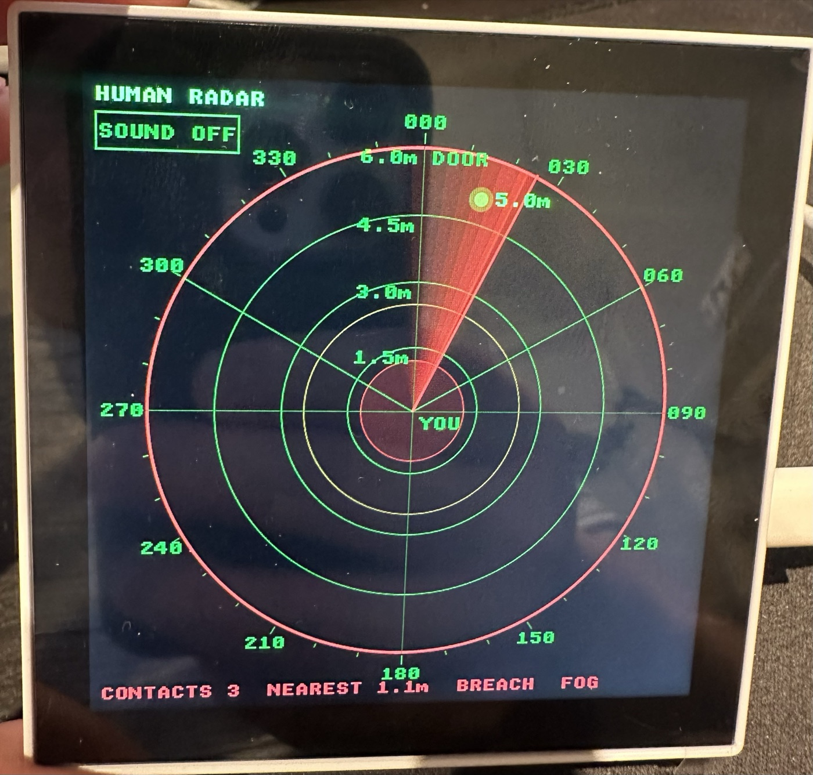

| Supported Targets | ESP32-P4 |
| ----------------- | -------- |

# Human Radar

A Halloween prop: a green "military" radar scope that watches the door, paints the people walking up behind you as fading blips, warns them with a voice, and when they get right behind you a pumpkin turns toward them, screams at them, strobes and pours fog. Built on the Waveshare ESP32-P4-WIFI6-Touch-LCD-4B with an HLK-LD2450 mmWave sensor sitting next to you on the table, facing the door. Until the sensor is wired up, a simulator sends fake visitors through the door.



*The scope during a breach: the outer ring and the footer turn red, the fog is on, and the sweep's afterglow follows the line around. The DOOR is straight ahead of the sensor, YOU are at the centre, the dashed lines mark the sensor's field of view.*

## Features

- 4" 720x720 phosphor-green radar scope: four range rings, the threat and breach zones, the sensor's field of view, bearing scale, rotating sweep with an afterglow trail, at about 30 fps
- Blips stay where the sweep painted them and fade until the next pass, with the distance tagged next to each one
- Four stages driven by the nearest person: CLEAR, CONTACT (someone came in), THREAT (inside 2.5 m: amber, "threat detected", the pumpkin turns toward them), BREACH (inside 1.2 m: red, "GET OUT", scream, fog, strobe). Escalation is instant, calming down takes a hold time and some distance
- Pumpkin effects on the expansion header: fog trigger, WS2812 LEDs (green breathing, amber pulse, red strobe) and a pan servo that stares at the nearest person
- Sounds on the built-in speaker: synthesised sonar pings and contact blips, plus voice and scream clips from `assets/` (placeholders generated with the Mac's `say`, replace them with your own). SOUND ON/OFF touch button under the title; muted at boot unless `CONFIG_SOUND_ON_AT_BOOT`
- Tap the scope to simulate a breach and run the whole sequence
- LD2450 driver included; simulated visitors walk in from the door, stand behind you, and leave
- Everything tunable with `idf.py menuconfig`

## Hardware Required

* [Waveshare ESP32-P4-WIFI6-Touch-LCD-4B](https://www.waveshare.com/esp32-p4-wifi6-touch-lcd-4b.htm) (ESP32-P4-Core module: ESP32-P4NRW32, 32 MB flash, 32 MB PSRAM)
  - 4" 720x720 IPS touch screen (ST7703 over 2-lane MIPI DSI, GT911 touch)
  - ES8311 codec + amplifier driving the speaker connector
  - Two USB-C ports: *USB TO UART* (CH343P, programming and console) and *USB OTG*
* Speaker on the board's speaker connector
* HLK-LD2450 24 GHz mmWave sensor (UART, 3 people, 6 m, +/-60 degrees)
* Pumpkin with: an ultrasonic fog maker behind a MOSFET/relay module, a WS2812 LED ring or strip, a hobby servo turning the pumpkin
* 5 V supply for the servo and LEDs (not from the board's USB)
* USB-C cable plugged into the **USB TO UART** port

## Project Structure

```
human-radar/
├── main/
│   ├── main.c                  # Boot order: display, scope, speaker, effects, scene, targets
│   ├── Kconfig.projbuild       # Scope, scene, effects, target source and sound options
│   ├── idf_component.yml       # BSP (panel, touch, LVGL, codec) and led_strip dependencies
│   ├── radar_ui/               # LVGL radar scope: grid canvases, sweep, blips, stage text, sound button
│   ├── scene/                  # Escalation state machine: stages, hysteresis, effects and voices
│   ├── sound/                  # Tone synthesiser, WAV clip player and mixer task for the speaker
│   ├── fog/                    # Fog trigger GPIO with timed bursts
│   ├── leds/                   # WS2812 patterns per stage
│   ├── servo/                  # Pan servo with limited turn speed
│   ├── targets/                # Shared list of tracked people (LD2450 coordinate convention)
│   ├── ld2450/                 # LD2450 UART frame parser
│   └── target_sim/             # Fake visitors until the LD2450 is connected
├── assets/                     # threat.wav, getout.wav, scream.wav (SPIFFS "storage" partition)
├── docs/                       # Screenshots
├── partitions.csv              # 8 MB app + 4 MB storage
├── sdkconfig.defaults          # Board-specific build defaults (target, flash, PSRAM, LVGL, BSP)
├── README.md
└── CMakeLists.txt              # Project build configuration
```

## Setup and Build

### 1. Install ESP-IDF

Follow the [ESP-IDF Getting Started Guide](https://docs.espressif.com/projects/esp-idf/en/latest/esp32p4/get-started/index.html) to install the ESP-IDF development framework (v5.5 or newer; this project is built with v6.1). The board support package, LVGL and the LED driver are fetched by the component manager on the first build.

### 2. Set the Target Chip

```bash
idf.py set-target esp32p4
```

The board-specific settings (32 MB flash, hex PSRAM at 200 MHz, ESP32-P4 silicon rev v1.x, LVGL and BSP options) come from `sdkconfig.defaults`.
They are applied only when `sdkconfig` is generated, so delete `sdkconfig` after changing the defaults.

### 3. Configure

```bash
idf.py menuconfig
```

Under *HUMAN RADAR ...*: scope settings, the scene ranges (threat 2.5 m, breach 1.2 m), the effect pins, the target source (enable the LD2450 and disable the simulator once the sensor is wired), and sound.

### 4. Build the Project

```bash
idf.py build
```

### 5. Flash and Monitor

Connect the **USB TO UART** port via USB-C and run:

```bash
idf.py flash monitor
```

To exit the serial monitor, press `Ctrl+]`. Flashing also writes the `assets/` clips to the storage partition.

If the board does not show up, hold BOOT while pressing RESET (or while plugging it in) to enter download mode.

If flashing stops with `requires chip revision in range v3.1 - v3.99`, the build was configured for the newer ESP32-P4 silicon. This board has rev v1.x, which `sdkconfig.defaults` selects with `CONFIG_ESP32P4_SELECTS_REV_LESS_V3`; delete `sdkconfig` and rebuild.

## How It Works

- `targets` holds the latest frame of tracked people in LD2450 coordinates (x to the right, y straight ahead, mm). The sensor sits next to you facing the door, so "far" is the door and "close" is behind you. The simulator and the LD2450 driver both publish frames with stable slot indexes.
- `scene` runs 20 times a second: it finds the nearest person and picks the stage. Going up is immediate; going down needs `CONFIG_SCENE_HYSTERESIS_MM` of extra distance and `CONFIG_SCENE_HOLD_MS`. THREAT plays the alarm and the "threat detected" clip (repeated), points the servo at the person and pulses the LEDs amber. BREACH strobes the LEDs red, fires the fog in bursts, alternates the scream and "get out" clips and keeps the servo on the person.
- `radar_ui` runs an LVGL timer every `CONFIG_RADAR_FRAME_PERIOD_MS`. The sweep angle follows the clock, and when it crosses a person's bearing it paints a blip there and plays a contact blip. The static grid is rendered once into three canvases (green, amber, red outer ring); a transparent full-screen object draws the moving parts and only the areas that changed are redrawn.
- `sound` renders 20 ms blocks of 16-bit mono PCM at 22050 Hz: tone tables for the effects, PSRAM-loaded WAV clips for the voices. Up to four voices overlap; silence is streamed while idle so the amplifier never pops.

### Replacing the voice clips

The clips are 16-bit mono WAV files at 22050 Hz in `assets/`; stereo files are mixed down. The placeholders were made on a Mac:

```bash
say -v "Bad News" --file-format=WAVE --data-format=LEI16@22050 -o assets/threat.wav "Threat detected."
```

Use any recording instead; keep the file names. A missing clip falls back to a synthesised sound.

## Pin Configuration (Waveshare ESP32-P4-WIFI6-Touch-LCD-4B)

The on-board peripherals are set up by the BSP. The add-ons use the free pins of the 2.0 mm expansion header P3; the other P3 pins are taken (GPIO7/8 I2C, GPIO37/38 programming UART, GPIO20/22 Wi-Fi module).

| Function              | GPIO    | Header P3 pin | Description |
|-----------------------|---------|---------------|-------------|
| LD2450 TX -> board RX | 2       | 7             | 256000 baud; sensor also needs 5V (pin 2) and GND (pin 4) |
| LD2450 RX <- board TX | 3       | 9             | Only needed for sensor configuration |
| Pumpkin servo signal  | 4       | 11            | 50 Hz PWM, LEDC timer 2 / channel 4 |
| Fog trigger           | 5       | 13            | MOSFET/relay module input, active HIGH by default |
| WS2812 LED data       | 21      | 12            | RMT, keep the wire short |
| UART0 TX / RX         | 37 / 38 | 6 / 8         | Serial console via the CH343P on the USB TO UART port |
| LCD backlight PWM     | 26      | -             | BL_PWM, LEDC timer 1 / channel 1 (BSP) |
| I2C SDA / SCL         | 7 / 8   | 3 / 5         | GT911 touch, ES8311 codec, ES7210 (BSP) |
| I2S / amplifier       | 9-13, 53| -             | Speaker path (BSP) |

All add-on pins can be changed with `idf.py menuconfig`.

## Resources

- [ESP-IDF Documentation](https://docs.espressif.com/projects/esp-idf/en/latest/esp32p4/)
- [Waveshare wiki: ESP32-P4-WIFI6-Touch-LCD-4B](https://docs.waveshare.com/ESP32-P4-WIFI6-Touch-LCD-4B)
- [BSP: waveshare/esp32_p4_wifi6_touch_lcd_4b](https://components.espressif.com/components/waveshare/esp32_p4_wifi6_touch_lcd_4b)
- [LVGL 9 documentation](https://docs.lvgl.io/9.3/)
- [HLK-LD2450 mmWave sensor](https://www.hlktech.net/index.php?id=1157)
